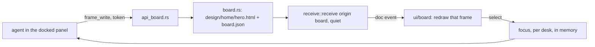
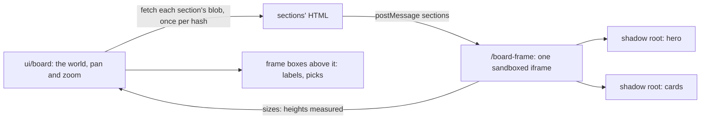

# A board

A board is a view over a desk (1.58, plan 6ff79c55a7): an empty canvas of
**sections** an agent draws (frames, before 1.62; the tools keep the word),
which the reader watches arrive with the panel they talk to docked with
them, below the board or beside it. It is a folder in the desk's folder, in
git, not a kind of desk. A desk has as many as it likes: each appears in the
desk's ⋯ menu, under Views, by its name, and ⋯ → New board or the board's
own title makes one (1.62, `POST /api/desks/{id}/boards`), empty.



## On disk

```
design/
  DESIGN.md        the look, in words; its first paragraph is in board_read
  tokens.css       the look, as custom properties; shown as swatches
  home/            a board, named by its folder
    board.json     name; per frame: id, name, w, h (0: its content's), x, y, order, hidden
    hero.html      one frame: a self-contained fragment, CSS inline
    cards.html
```

- Names: a board's folder and a frame's id are `^[a-z0-9][a-z0-9-]{0,63}$`,
  checked before any path is built.
- Paths: `design/` and the board's folder are made if missing, one level at
  a time, each canonicalized and kept under the canonical desk root. The
  frame's file is joined after that, since a new frame has no file yet. A
  frame file that is a symlink is not read; a write replaces it by rename.
- `board.json` is written atomically with its keys in order. It is read
  leniently for showing (what can be read of it, frame by frame) and strictly
  for writing: a file that does not parse is refused, never overwritten.
- The folder is the truth. A `.html` file in a board's folder that
  `board.json` does not name (written with Claude's Write tool, or by hand)
  is on the board too, after the rest, at 800 × 600.

## Versions

Every `frame_write` is a document version: `board::send` puts the file through
`receive::receive` with origin `board`, the desk's project and workflow
`board:<board>`.

- **Quiet.** Listed under the board's one workflow row, never waiting: no
  inbox count, no chime. The reader is watching the board.
- **A burst is one version.** A board write within 20 s of the board write
  before it, to the same frame, replaces that version in place
  (`BOARD_COALESCE_SECS`). A board write never coalesces with a hook's or a
  watch's, nor they with it.
- **Handed over.** `send_document` of a frame's bytes takes the quiet version
  over, as it does a hook's draft, and the frame becomes a document that
  waits to be read.
- **Nothing deleted.** Hiding is `hidden: true` in `board.json`; the file and
  every version stay.

## Shown (1.62)

A board was one iframe per frame: a document, a script realm and a layer
each, at a size the agent guessed, since a sandboxed frame cannot be
measured. Now all of a board's sections are drawn in **one** document.



- `/board-frame` answers a page that holds only the runtime
  (`ui/board-frame.js`), inlined under a nonce made for that answer:
  `script-src 'nonce-…'`, `connect-src 'none'`, `form-action 'none'`,
  `frame-ancestors 'self'`. It is loaded in an iframe with
  `sandbox="allow-scripts"` and no `allow-same-origin`: an opaque origin,
  nothing of the page's. A section's inline handler or `javascript:` link is
  refused by the nonce; `innerHTML` never runs a `<script>`.
- The window fetches each section's HTML from its document's route
  (`/api/docs/{id}/blob?h=`) and posts it in once per hash; the runtime puts
  each in a closed shadow root, with `html`, `body` and `:root` in its CSS
  made `:host` (the export does the same, `board::host_selectors`). The
  tokens are set on the document's root once, and inherit into every root.
- A section without a height is as tall as its content: a ResizeObserver in
  the runtime posts heights back, and the window sizes the frame boxes and
  the iframe by them. Nothing the runtime posts is anything but numbers,
  clamped.
- The iframe sits in the world at the sections' bounding box, so pan and
  zoom move it with the boxes and nothing is synced on a pan.
- A frame with a `<script>` is an **island** (`board::is_island`, `island`
  in the read): shown as before, its own iframe from its document's route,
  `ISLAND_H` (600) tall unless it has a height. Frames from before 1.62 that
  ran a script keep working.

The reader's hands are select, pan and zoom. The documents take no pointer,
so a click on a section's box selects it. Selecting is the reader's focus:
the agent reads it in the brief and through `board_read` or `read_focus`.

Board versions stay in the store but are not in the Inbox list or the
desk's Documents (V5): the board is where they are read.

## Live (1.61)

A frame can name a `source` in `board.json` (`board_arrange` sets it; today
`threads`, `told::SOURCES`). The board's read then carries `live: {"<frame
id>": {...}}`, from `told::health`: shipped, told, the share told, the
median hours from merge to told, and the last eight threads with both
stamps. The read's hash covers them, so a board whose numbers did not move
reads as unchanged.

A section's `[data-live="name"]` slots are filled by the runtime from
`{t: "live", id, data}` (a dotted name reaches inside), with no script in
the section. An island still gets `{snyvi: "live", source, data}` posted
into its own iframe after it loads, and again only when the numbers moved; a
thread moving on the desk (the `desknotes` event) has an open board read
again. The target origin is `"*"`, because a sandboxed frame without
`allow-same-origin` has an opaque origin and no other target reaches it.
That is safe for what goes: only numbers the window already holds, only into
a frame it made, and the window listens to nothing a frame posts. The CSP,
the sandbox and no network are as in Shown.

## The agent

The skill's `board.md` is what the agent is told. In short: read DESIGN.md
and tokens.css first; one small self-contained frame per call; variants as a
row of frames; look at the frame before saying done; read the selection
before acting on "this"; never delete.

| Tool | Route (token, through `agent_pane`) |
|---|---|
| `board_read` | `GET /api/panes/{id}/board/{board}`; no board: `GET /api/panes/{id}/boards` |
| `frame_write` | `POST /api/panes/{id}/board/{board}/frames/{frame}`; `html: null` → `…/hide` |
| `board_arrange` | `POST /api/panes/{id}/board/{board}/arrange` |
| `frame_look` | `POST /api/panes/{id}/board/{board}/look/{frame}` (501 until the window can draw it) |
| `board_export` | `GET /api/panes/{id}/board/{board}/export` |

| `read_focus` | `GET /api/panes/{id}/focus` |

The page reads the same board on the capability,
`GET /api/desks/{id}/board/{board}`, and sets the focus with
`POST /api/desks/{id}/focus`. Every write, hide or arrange is told as a
`board` event (`{desk, board}`), which the open Board view reloads on: a
frame's version is a `doc` event too, but a quiet one reaches the sidebar, not
the desk.
