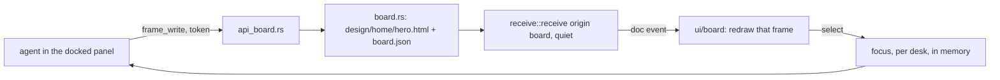

# A board

A board is a view over a desk (1.58, plan 6ff79c55a7): frames an agent draws,
which the reader watches arrive with the panel they talk to docked with
them, below the board or beside it. It is a folder in the desk's folder, not a kind of desk. The view
appears in the desk's ⋯ menu, under Views, when the folder exists (1.60).



## On disk

```
design/
  DESIGN.md        the look, in words; its first paragraph is in board_read
  tokens.css       the look, as custom properties; shown as swatches
  home/            a board, named by its folder
    board.json     name; per frame: id, name, w, h, x, y, order, hidden
    hero.html      one frame: a self-contained fragment, CSS inline
    cards.html
```

- Names: a board's folder and a frame's id are `^[a-z0-9][a-z0-9-]{0,63}$`,
  checked before any path is built.
- Paths: `design/` and the board's folder are made if missing, one level at
  a time, each canonicalized and kept under the canonical desk root. The
  frame's file is joined after that, since a new frame has no file yet. A
  frame file that is a symlink is not read; a write replaces it by rename.
- `board.json` is written atomically with its keys in order. It is read
  leniently for showing (what can be read of it, frame by frame) and strictly
  for writing: a file that does not parse is refused, never overwritten.
- The folder is the truth. A `.html` file in a board's folder that
  `board.json` does not name (written with Claude's Write tool, or by hand)
  is on the board too, after the rest, at 800 × 600.

## Versions

Every `frame_write` is a document version: `board::send` puts the file through
`receive::receive` with origin `board`, the desk's project and workflow
`board:<board>`.

- **Quiet.** Listed under the board's one workflow row, never waiting: no
  inbox count, no chime. The reader is watching the board.
- **A burst is one version.** A board write within 20 s of the board write
  before it, to the same frame, replaces that version in place
  (`BOARD_COALESCE_SECS`). A board write never coalesces with a hook's or a
  watch's, nor they with it.
- **Handed over.** `send_document` of a frame's bytes takes the quiet version
  over, as it does a hook's draft, and the frame becomes a document that
  waits to be read.
- **Nothing deleted.** Hiding is `hidden: true` in `board.json`; the file and
  every version stay.

## Shown

A frame is shown exactly as an HTML document is (`ui/app/04-doc.js`): an
iframe with `sandbox="allow-scripts"` and no `allow-same-origin`, loaded by
`src` from the document's route, `/api/docs/{id}/blob`, which answers with
the document's own CSP (`api_docs::protect`). Its scripts run, but it has an
opaque origin, no network and no reach into the page. It is never loaded by
`srcdoc`, which would give the frame this page's CSP instead. The URL carries
the frame's hash (`?h=`), because a burst rewrites one document id in place.

The reader's hands are select, pan and zoom. The iframes take no pointer, so
a click on a frame selects it. Selecting is the reader's focus: the agent
reads it in the brief and through `board_read` or `read_focus`.

## The agent

The skill's `board.md` is what the agent is told. In short: read DESIGN.md
and tokens.css first; one small self-contained frame per call; variants as a
row of frames; look at the frame before saying done; read the selection
before acting on "this"; never delete.

| Tool | Route (token, through `agent_pane`) |
|---|---|
| `board_read` | `GET /api/panes/{id}/board/{board}` |
| `frame_write` | `POST /api/panes/{id}/board/{board}/frames/{frame}`; `html: null` → `…/hide` |
| `board_arrange` | `POST /api/panes/{id}/board/{board}/arrange` |
| `frame_look` | `POST /api/panes/{id}/board/{board}/look/{frame}` (501 until the window can draw it) |
| `board_export` | `GET /api/panes/{id}/board/{board}/export` |

| `read_focus` | `GET /api/panes/{id}/focus` |

The page reads the same board on the capability,
`GET /api/desks/{id}/board/{board}`, and sets the focus with
`POST /api/desks/{id}/focus`. Every write, hide or arrange is told as a
`board` event (`{desk, board}`), which the open Board view reloads on: a
frame's version is a `doc` event too, but a quiet one reaches the sidebar, not
the desk.
