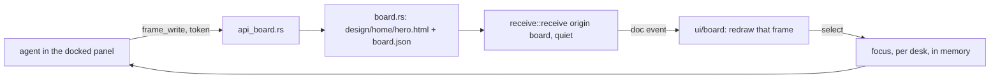
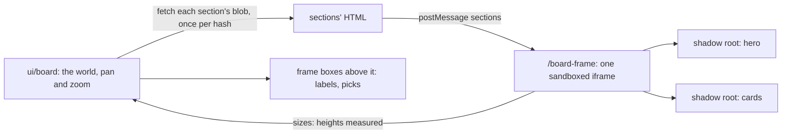

# A board

A board is a view over a desk (1.58, plan 6ff79c55a7): an empty canvas of
**sections** an agent draws (frames, before 1.62; the tools keep the word),
which the reader watches arrive with the panel they talk to docked with
them, below the board or beside it. It is a folder in the desk's folder, in
git, not a kind of desk. A desk has as many as it likes. They are reached
from the head's view switcher (1.68, docs/DESK.md): its Boards segment, or
the board's own title, opens **the boards list**, the one place a board is
opened, made (`+ New board…`, asking the name first,
`POST /api/desks/{id}/boards`), renamed, moved and removed.



## On disk

```
design/
  DESIGN.md        the look, in words; its first paragraph is in board_read
  tokens.css       the look, as custom properties; shown as swatches
  home/            a board, named by its folder
    board.json     name; per frame: id, name, w, h (0: its content's), x, y, order, hidden
    hero.html      one frame: a self-contained fragment, CSS inline
    cards.html
```

- Names: a board's folder and a frame's id are `^[a-z0-9][a-z0-9-]{0,63}$`,
  checked before any path is built.
- Paths: `design/` and the board's folder are made if missing, one level at
  a time, each canonicalized and kept under the canonical desk root. The
  frame's file is joined after that, since a new frame has no file yet. A
  frame file that is a symlink is not read; a write replaces it by rename.
- `board.json` is written atomically with its keys in order. It is read
  leniently for showing (what can be read of it, frame by frame) and strictly
  for writing: a file that does not parse is refused, never overwritten.
- The folder is the truth. A `.html` file in a board's folder that
  `board.json` does not name (written with Claude's Write tool, or by hand)
  is on the board too, after the rest, at 800 × 600.

## Versions

Every `frame_write` is a document version: `board::send` puts the file through
`receive::receive` with origin `board`, the desk's project and workflow
`board:<board>`.

- **Quiet.** Listed under the board's one workflow row, never waiting: no
  inbox count, no chime. The reader is watching the board.
- **A burst is one version.** A board write within 20 s of the board write
  before it, to the same frame, replaces that version in place
  (`BOARD_COALESCE_SECS`). A board write never coalesces with a hook's or a
  watch's, nor they with it.
- **Handed over.** `send_document` of a frame's bytes takes the quiet version
  over, as it does a hook's draft, and the frame becomes a document that
  waits to be read.
- **Nothing deleted.** Hiding is `hidden: true` in `board.json`; the file and
  every version stay. Removing a whole board (1.68) is a mark beside the
  boards, below; its folder stays.

## The boards list (1.68, plan d2db60758c)

`ui/desk/33-switch.js`. Each board a row, in the reader's order -- the one
on screen ticked, "3 new", how many sections -- and a ⋯ with Rename, Move
up, Move down and Remove. Focus stays on the row acted on; ↑ ↓ move, Enter
opens, F2 renames, ⌫ removes, Esc goes back out.

| What | Where |
|---|---|
| order, removed | `design/boards.json`: `{"order": ["home", …], "removed": {"scratch": 1795182061}}`, written whole and atomically, in git with the boards (`board::Shelf`). A board it does not order goes after the rest, by folder name; a file broken by hand is read as no order |
| Move up, Move down | `POST /api/desks/{id}/boards/order` `{order: [...]}` (capability), the whole order |
| Remove, Undo, Bring back | `POST /api/desks/{id}/board/{board}/remove` `{removed: bool}` (capability). The row says `Removed · Undo` in place for 6 s; Removed (n) at the list's foot and ⋯ → Recently closed bring it back. Removing the board on screen opens the next one, or the panels, and the Undo is under the Boards segment |

A removed board is out of the desks list's `boards` and `views` (it is in
`removed_boards`), out of `board_read`'s list, and `open_view` cannot open
it. `frame_write`, `board_arrange`, hide and shared CSS on it are refused,
the reader's own rename too: "the reader removed the board; ask them to
bring it back from Removed". A write never brings it back behind the
reader's back, and an agent has no route or tool to remove one. `create`
never takes a removed board's folder name: its folder is still there.

## Shown (1.62)

A board was one iframe per frame: a document, a script realm and a layer
each, at a size the agent guessed, since a sandboxed frame cannot be
measured. Now all of a board's sections are drawn in **one** document.



- `/board-frame` answers a page that holds only the runtime
  (`ui/board-frame.js`), inlined under a nonce made for that answer:
  `script-src 'nonce-…'`, `connect-src 'none'`, `form-action 'none'`,
  `frame-ancestors 'self'`. It is loaded in an iframe with
  `sandbox="allow-scripts"` and no `allow-same-origin`: an opaque origin,
  nothing of the page's. A section's inline handler or `javascript:` link is
  refused by the nonce; `innerHTML` never runs a `<script>`.
- The window fetches each section's HTML from its document's route
  (`/api/docs/{id}/blob?h=`) and posts it in once per hash; the runtime puts
  each in a closed shadow root, with `html`, `body` and `:root` in its CSS
  made `:host` (the export does the same, `board::host_selectors`). The
  tokens are set on the document's root once, and inherit into every root.
- A section without a height is as tall as its content: a ResizeObserver in
  the runtime posts heights back, and the window sizes the frame boxes and
  the iframe by them. Nothing the runtime posts is anything but numbers,
  clamped.
- The iframe sits in the world at the sections' bounding box, so pan and
  zoom move it with the boxes and nothing is synced on a pan.
- A frame with a `<script>` is an **island** (`board::is_island`, `island`
  in the read): shown as before, its own iframe from its document's route,
  `ISLAND_H` (600) tall unless it has a height. Frames from before 1.62 that
  ran a script keep working.

The reader's hands are select, pan and zoom. The documents take no pointer,
so a click on a section's box selects it. Selecting is the reader's focus:
the agent reads it in the brief and through `board_read` or `read_desk`'s `focus`.

Board versions stay in the store but are not in the Inbox list or the
desk's Documents (V5): the board is where they are read.

## Live (1.61)

A frame can name a `source` in `board.json` (`board_arrange` sets it; today
`threads`, `told::SOURCES`). The board's read then carries `live: {"<frame
id>": {...}}`, from `told::health`: shipped, told, the share told, the
median hours from merge to told, and the last eight threads with both
stamps. The read's hash covers them, so a board whose numbers did not move
reads as unchanged.

A section's `[data-live="name"]` slots are filled by the runtime from
`{t: "live", id, data}` (a dotted name reaches inside), with no script in
the section. An island still gets `{snyvi: "live", source, data}` posted
into its own iframe after it loads, and again only when the numbers moved; a
thread moving on the desk (the `desknotes` event) has an open board read
again. The target origin is `"*"`, because a sandboxed frame without
`allow-same-origin` has an opaque origin and no other target reaches it.
That is safe for what goes: only numbers the window already holds, only into
a frame it made, and the window listens to nothing a frame posts. The CSP,
the sandbox and no network are as in Shown.

## The reader's hands (1.67)

Until 1.67 the reader could select, pan and zoom. The foot bar now carries
what can be done with what is picked (`ui/board/07-acts.js`), at the same
height, so nothing moves:

| Press | What happens |
|---|---|
| This one · Change… | The reader's press, typed into the docked Claude in snyvi's sentence, only at its prompt (else copied). The sentence names the board's folder and the section's id, which are slugs, never a name or other text an agent wrote; Change… adds the reader's own words |
| ‹ v2 of 3 › | An earlier version drawn in the section's place (`GET /api/desks/{id}/board/{board}/frames/{frame}/versions`), until the reader steps back or it is written again |
| Open as a document | The section's document, read over the desk |
| Copy picture | A PNG of the section on the clipboard |
| Hide | `hidden: true`, as the agent's hide (`POST /api/desks/{id}/board/{board}/frames/{frame}/hide`); "2 hidden" in the top bar lists them, each with Show |

The board keeps the zoom and place the reader left it at, in the window's
storage by desk and board, and has an address (docs/DESK.md, Ways to a
board).

**A picture of a section.** The daemon has no browser. `board_read` with `look` says a
`look` event (`{desk, board, frame, n}`); a window on that desk draws the
section alone in a `/board-frame` of its own, out of sight, and asks the
runtime for its picture: the section's markup in an SVG `foreignObject`,
drawn on a canvas, read back as a PNG. The window posts it to
`POST /api/desks/{id}/board/{board}/look/{n}` (capability), and the waiting
`look` answers with it as an image. Only a PNG is passed on, to a look
still waiting, within 4 s; otherwise the agent is told to render the file
itself, as before. The picture holds nothing loaded from the network (a web
font, a picture by URL), and an island cannot be drawn this way.

**Shared CSS.** `design/<board>/board.css` is put before every section's own
`<style>`, in the window, the picture and the export. The agent writes it
whole with `board_arrange`'s `css` (16 KB at most) and reads it in
`board_read`. It is not a frame, and an island does not get it.

**What is new.** The desks list carries, for each board, when each shown
section's file last changed (`marks`). The window counts those newer than
when the reader last had the board on screen. Since 1.68 a dot on the
switcher's Boards segment says so in every view, and the boards list counts
each board's; a board an agent made that this window never had open gets a
card under the segment once, `Claude made a board · pricing · Open`, naming
the panel when the `board` event said it (`by`). It stays until opened, put
away, or the desk left. Board versions stay out of the Inbox, as before.

## The agent

The skill's `board.md` is what the agent is told. In short: read DESIGN.md
and tokens.css first; one small self-contained frame per call; variants as a
row of frames; look at the frame before saying done; read the selection
before acting on "this"; never delete.

| Tool | Route (token, through `agent_pane`) |
|---|---|
| `board_read` | `GET /api/panes/{id}/board/{board}`; no board: `GET /api/panes/{id}/boards` |
| `frame_write` | `POST /api/panes/{id}/board/{board}/frames/{frame}`; `html: null` → `…/hide` |
| `board_arrange` | `POST /api/panes/{id}/board/{board}/arrange` |
| `board_read` `look` | `POST /api/panes/{id}/board/{board}/look/{frame}`: a picture from a window on the desk (1.67), else 501 with the file and size to render |
| `board_arrange` `export` | `GET /api/panes/{id}/board/{board}/export` |

| `read_desk` `focus` | `GET /api/panes/{id}/focus` |

The page reads the same board on the capability,
`GET /api/desks/{id}/board/{board}`, and sets the focus with
`POST /api/desks/{id}/focus`. Every write, hide or arrange is told as a
`board` event (`{desk, board}`), which the open Board view reloads on: a
frame's version is a `doc` event too, but a quiet one reaches the sidebar, not
the desk.
