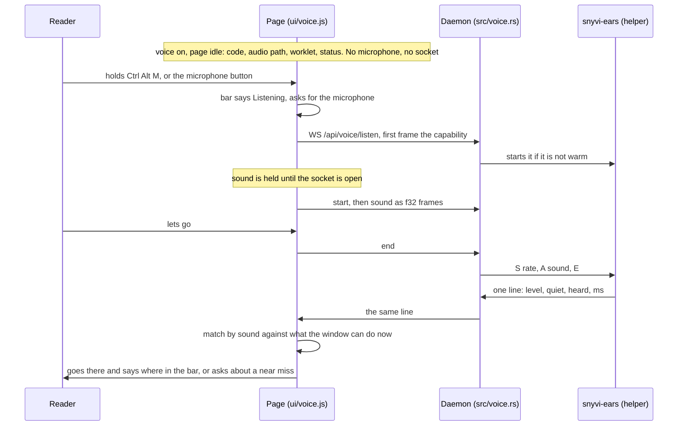

# Voice

Hold a key, say a command, let go. snyvi takes you there: a desk, a panel, a
view, anything in the palette. Since 1.70.0, on Linux first.

It is off until the reader fetches it, and it is a way to move about and no
more. It never types into a panel, sends, or approves.

## The flow



## How it feels

What the reader sees and does, and why (plan f87adbb180, audit b56b6ceccd).

- **Ready before the key.** A window where voice is on fetches the code,
  makes the audio path and loads the worklet at idle. The microphone opens on
  M and the socket beside it; sound is held in the page until the socket is
  open. The socket is not held open ahead: opening it wakes the helper.
- **Not on Ctrl and Alt.** Opening the microphone before M is written and
  off (`localStorage` `snyvi.voice.early` = 1). Ctrl and Alt are the desk's
  own keys, so it would open the microphone on every ⌃⌥2. AltGr never
  starts a take.
- **One bar.** "Listening" from key down. The meter is dim until the
  microphone is open; then it is live and the bar is edged in the accent.
  After the key comes up nothing new is said for 400 ms; "Waking…" only when
  the helper was asleep. The first key after an arrival takes the bar down.
- **What you can say.** Held a second in silence, a line above the bar
  offers three things from this view. The whole list folds out in the sheet.
- **Back.** "back" and "go back" are the window's back arrow.
- **The button.** In the sidebar's foot once voice is on; hold it with the
  pointer or Space. Filled while the microphone is open. Not on the folded
  sidebar.
- **A near miss is asked.** One command just under its bar: "Back?" and a
  tap of the voice key says yes. Any other key drops it and goes where it was
  going. Nothing runs without the tap.
- **Errors say what to do**, in `plain`.

Every wait is a constant at the top of `ui/voice.js`.

## The parts

| Part | Where | What it holds |
|---|---|---|
| The helper | `ears/` (its own workspace, never in the daemon's build) | sherpa-onnx with the Moonshine base model; reads frames on stdin, answers a JSON line a take |
| Its build | `.github/workflows/ears.yml`, called by `release.yml` | five platforms, `snyvi-ears-<os>-<arch>.tar.gz`, and the model packed once as `snyvi-ears-model-en.tar.gz` |
| The daemon's side | `src/voice.rs`, `src/server/api_voice.rs` | fetch by the signed manifest, on and off, remove, the pipe, warm for ten idle minutes |
| The window's yes | `src/bin/app.rs` `microphone` | audio only, for snyvi's own page, nothing else |
| The page | `ui/voice.js`, `ui/voice-worklet.js`, `ui/desk/35-voice.js` | the take, the bar, the match, the sheet |

## What holds

- **Sound stays on the machine.** The helper runs here, from files fetched
  once. Nothing heard is sent anywhere, kept on disk, or logged.
- **The window's, never an agent's.** Every voice route is behind the
  capability. A token opens none of them: an agent cannot start a take, send
  sound in, or read what was heard.
- **The daemon acts on no word.** It hands the helper's line back to the page
  that sent the sound. What a phrase means is decided in the reader's window,
  against the same commands the palette runs.
- **It moves, it does not act.** A match opens a desk, focuses a panel, opens
  a view or picks a palette command. Nothing reaches a PTY.
- **A miss costs a repeat, never a wrong command.** The match is by sound
  (letters and consonant skeleton), with a bar, a higher bar for short
  phrases, and a margin over the runner-up. `bench/voice.mjs` holds both
  edges against the phrases the model really gave.
- **Nothing shifts.** The bar and the sheet lie over the page.

## The download

`latest.json` names two more roles under each platform, `ears` and
`ears-model`, signed with everything else. `POST /api/voice/fetch` verifies
the manifest's signature and each archive's checksum, unpacks beside the
data (`<data>/voice/{ears,model,installed.json}`), and keeps the model when a
later fetch brings only a new helper. Older daemons ignore the roles.

The helper speaks frames `0.1`; a daemon starts only a helper whose version
begins with that, and says "fetch voice again" otherwise.

## The helper's frames

stdin: a tag, a u32 length (little-endian), a payload. `S` a u32 sample rate,
`A` f32 mono samples, `E` the end of a take. stdout: `{"ready":true,…}` once,
then a line a take: `{"level","quiet","speech_ms","heard","ms"}`. A bad frame
is exit 2 with the reason on stderr. `snyvi-ears --wav FILE` hears one file.

## Measured

On a 2011 four-core desktop (i5-2500K) under load: a command is heard in
90 to 170 ms from the key coming up, three seconds of speech in about 390.
The helper starts in a second and holds about 220 MB while warm; it stops
after ten idle minutes.

```
node bench/voice.mjs --check
SNYVI_BENCH_VOICE=<data dir> SNYVI_BENCH_VOICE_WAV=<command.wav> snyvi bench
cd ears && SNYVI_EARS_MODEL=<model dir> cargo test
```

## Not yet

- macOS and Windows: the helper builds for both, the window's microphone
  consent is written for Linux only. `SNYVI_VOICE=1` offers it elsewhere for
  testing.
- Words other than English, dictation, a wake word.
- A page test with a stand-in microphone. `bench/voice.mjs` checks the
  match, the near miss and the hints; nothing yet drives a take in a page.
