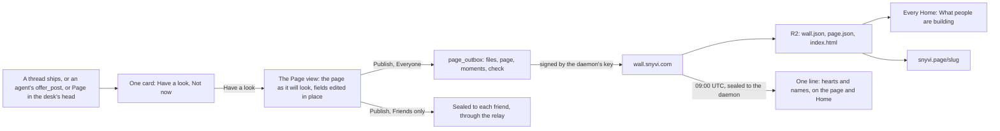
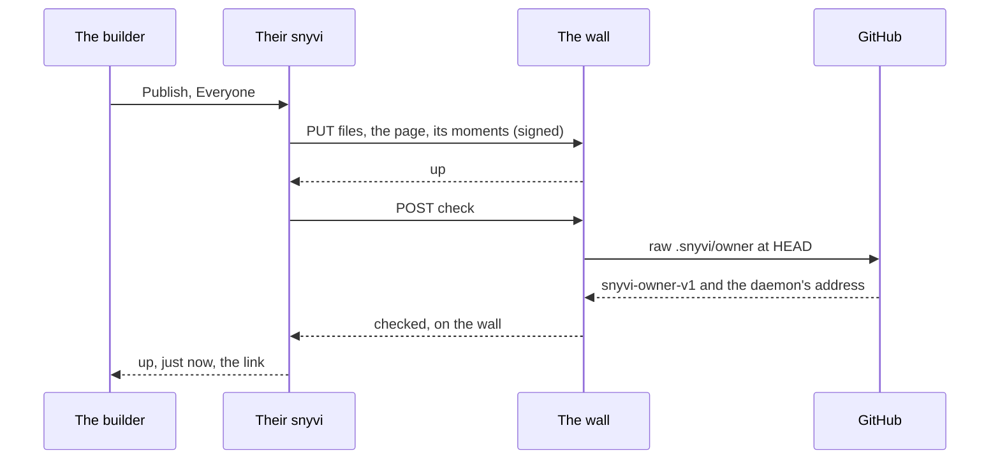

# What people are building

A builder's desk can have a **page**: a landing page drafted from the
desk, in snyvi's look, with a logo, a lede, links, its GitHub and its
**moments** (a chapter accepted, a release, a clip). The builder puts it
on a press either on **the wall**, which is every snyvi Home's *What
people are building* and `snyvi.page/<slug>`, or to **friends only**,
sealed through the relay as a document goes. What others say comes back
once a day as one line with names.

Plans: 48ca2d5b9e (rev 3, the build), dc186f8f47 (directions), 31683167fd
(hosting), 40303cb7e4 (the design round).

## The promise

Nothing leaves your machine unless you press. A document goes sealed to a
paired friend. A page goes to the wall, in the clear, signed by you, and
you can take it down. What others say comes back to you as words you read;
it never reaches an agent unless you make it a note.

Reading is not pressing, and is said plainly: while Home shows *What
people are building*, the daemon asks the wall for `wall.json` at most
once an hour, and for a card's pictures once each, kept here after. Those
are plain GETs with nothing of yours in them, and the window itself never
fetches the internet. Hide the section and it is never asked.

## Before and after

| | Before 1.59 | From 1.59 |
|---|---|---|
| What leaves the machine | a document you pressed Send on, sealed to a friend | that, and a page you pressed Publish on: to the wall in the clear and signed, or to friends sealed |
| Who sees your work | the friends you send it to | anyone you put your page in front of, and every snyvi Home once its check is in your repository |
| What comes back | a friend's reply, a tick | that, and the hearts on your page, once a day, with names |
| What an agent can do | send you documents, offer one to a friend | that, and offer a moment for your page with `offer_post`: a card, never a publish |

## How it flows

## The six rules

1. **A press is the only way out.** The page, a moment, a file leave on the
   reader's Publish in the Page view, through the window's capability. A
   token never publishes: an agent's `offer_post` makes a card and nothing
   else.
2. **What the wall holds is what you signed.** The page's own fields and
   files, and this daemon's public keys. No desk id, no folder, no draft,
   no provenance, nothing of the machine.
3. **The wall shows only checked pages.** A page is at `snyvi.page/<slug>`
   once it is up; it is on Everyone's wall only once its repository's
   `.snyvi/owner`, at HEAD, names the daemon's address. *Add the check to
   the repo* writes the file; the commit and the push are yours.
4. **A slug is the first key's** (D4). It is yours to change until the
   first publish goes through (D2); after that it stays, and anyone else
   who asks for it is told *that name is taken*.
5. **Taking it down takes it down.** The wall drops its rows and files
   within the minute; your page stays here, off. A friend keeps the copy
   they were sent.
6. **What comes back is shown, never run.** The daily line is from the
   wall's own key alone (`WALL_KEY`), opened like a friend's frame, and
   only its hearts, names and report count are kept, on the page and on
   Home. It never reaches a pane.

## The words

*What people are building* · *Your page* · *Put it on the wall* · *a
moment* · *I'd use this* / *I'd read this* / *I'd try this*, by tone ·
*Friends only* · *Off* · *up · just now* · *Shipped. Put it on your page?*

Never: launch, post, like, follower, trending, streak.

## What the wall service holds

The wall is `wall/` (README there): one Worker, D1 and R2, observability
off. It holds, in the clear, what a builder signed: pages, moments, files,
under the daemon's public key; the hearts by the key that gave them; the
reports, counted (1.59 counts them and an operator acts on them; automatic
hiding is 1.60's). It never holds an account, a name that is not a page's
own title, or a log of who read what. Reads are R2 through the cache.

**Takedowns.** Open an issue at https://github.com/snymrova/snyvi/issues
with the page's address (a mailbox for this is still to be named). The
operator hides it at once (`npm run hide -- <slug>`), off the wall and off
snyvi.page, and its owner can take it down for good.

## Where it lives in the code

| | |
|---|---|
| `src/page.rs`, `src/page/{draft,accent,files}.rs` | the page, its moments, its cards; the draft from the desk; the accent from the logo; files copied in |
| `src/server/api_page.rs` | the Page view's routes, `offer_post`'s, `/pages/{file}`, door (a) |
| `src/wall.rs`, `src/server/api_wall.rs` | signing, the outbox, the press, the daily line, Home's `/api/wall` |
| `src/mcp/page.rs` | `offer_post` |
| `ui/desk/27-page.js`, `ui/page.js` | Page in the switcher, the card, the view |
| `ui/wall.js` | Home's section |
| `wall/` | the service |
