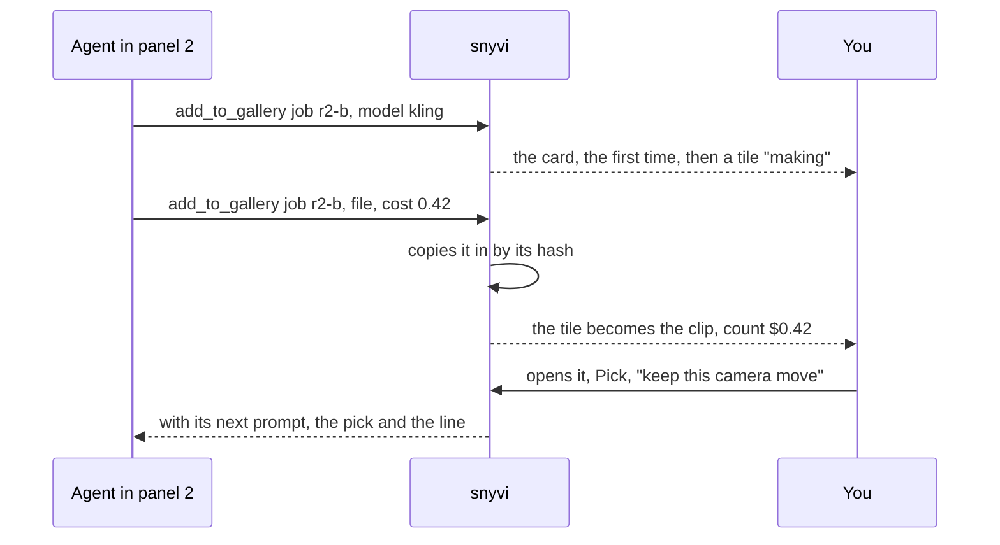
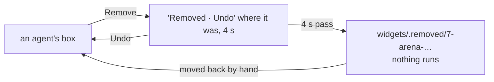
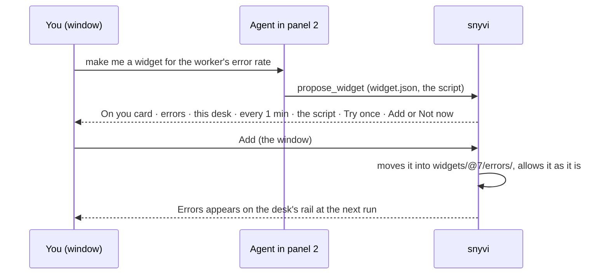
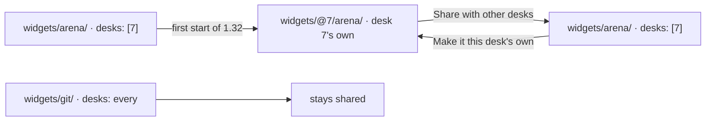

# Widgets and the sidebars

snyvi's two sidebars are made of sections, and you arrange them on
`/sidebars` (⌘K → Arrange sidebars, or right-click any section's head).
Widgets are small sections that anything can fill: an agent, a script, or a
widget file snyvi runs on a timer.

> **The left is global. The right is the desk you are on.** A section's
> scope decides its side, so nothing changes sides, and the sidebars never
> redraw because you clicked somewhere.

## Arranging

| Side | Sections, in today's order |
|---|---|
| Left, on every page | Inbox · Desks · Folders · Widgets (the global ones) |
| Right, on a desk | Panels · Points · Documents · Notes · Widgets (this desk's) |

- Drag a row on `/sidebars`, or move it with Alt+↑ ↓. Each change is saved
  as you make it, and the sidebars move with it, in every window.
- A switch turns a section off. Off is not gone: it stays on the list, and
  the same switch brings it back. **Reset to default** brings back today's.
- On you (Your turn, before 1.36) and Suggested aren't on the right since 1.32: they wait in the
  desk's bottom-right corner, behind its **On you** pill, so an agent's
  card to allow a box or add a widget is there.
- Every section folds from its head, and a folded head keeps its count.
  Folds are per browser; the layout is the daemon's.

## Three ways to fill a widget

| Way | Who | Lives |
|---|---|---|
| MCP `set_widget` | an agent in a desk's panel, **after your yes** on On you | on that desk until cleared, or for as long as you said on the card; dims after `stale_after` (30 min), and says "panel 2 closed" when its panel closes |
| `snyvi widget set` | scripts, git hooks, cron, CI | until cleared; on a desk with `--desk ID`, global otherwise (or the panel's desk, run inside one) |
| a widget file | you, or an agent through `propose_widget` (a card, Add) | while it is switched on, on its desk (or the desks you shared it with), for as long as you chose; run while it is in view |

**What an agent may make one for** (1.32): only when you asked, and only for
a figure that changes by itself and that you'd otherwise go and check (CI
3/5 green, a deploy running, a dev server up), as a count and one short
line. Not a to-do of yours (that's `hand_over`, on On you), not how to do
something (the agent's reply), not news (a document), and not what changes
only when you act.

A box is its name, its count and its body. Who writes it, and how often,
is the name's tip.

All three send the same thing: **Markdown**, or **one JSON object**:

```json
{ "body": "**deploy** 3/5 green", "tone": "ok", "count": "3/5", "lines": 2, "stale_after": 600 }
```

| Field | | |
|---|---|---|
| `body` | Markdown, 1,500 characters at most | text, bold, code, links, lists. HTML is dropped; a picture shows as its alt text (a gallery's tiles are below); a table as its pipes; a heading or a code block renders, but takes room. Empty clears the widget |
| `tone` | `ok`, `warn`, `bad`, `none` | colours the count. `good`, `warning`, `error`, `fail`, and `green`, `yellow`, `red` read as those |
| `count` | 8 characters at most | beside the name, kept while folded: `3`, `!2`, `3/5` |
| `lines` | 1–6 (3) | the body's room, 20 px a line. A longer body is cut and opens on a click; a new one never moves what's below |
| `stale_after` | seconds (1800); 0 is never | after it the widget dims |

Names are lowercase letters, digits and dashes, 32 at most. A desk has six
widgets at most and the left eight. A name a widget file has is that file's:
a push to it is refused.

```sh
snyvi widget set backups --tone ok --count "03:00" "Nightly backup **done**"
snyvi widget set ci --desk 3 < ci-summary.json
snyvi widget clear backups
```

## A gallery

A box an agent fills with what an image or a video model made for you:
its newest outputs as square tiles in one row, in the room the box keeps
(4 lines, 76 px tiles, by default). A tile still being made says so and
becomes the picture where it stands; one that failed is marked, and says
why in its tip. The count is what they cost together (`$0.84`), or how many
there are.

- **Click a tile** to see it big, over the desk: ‹ › and ← → step through
  the outputs, newest first, with each one's caption, model, cost and
  prompt. A clip plays there.
- **All desks**, beside the arrows, shows every desk's galleries instead of
  this one's, each marked with its desk. The switch is remembered in this
  browser.
- **Pick**, with a line ("warmer, closer"): the panel that made it hears
  *You answered "Which one in the gallery?": #3 "warm": warmer,
  closer (/…/r2-b.png)* on its next prompt, as an answer on On you reaches
  it. If that panel has closed, the next panel on the desk to prompt hears it.

| Who | How |
|---|---|
| an agent in a panel | MCP `add_to_gallery`: `file`, `job`, `caption`, `model`, `prompt`, `cost` (dollars), `poster`, `failed`, `name` (`gallery`), `lines`, `for` (how long, on the first card) |
| a script | `snyvi gallery add out.png --caption warm --model flux --cost 0.04 --desk 3` |

- **A file, never a URL.** The agent downloads what the model gave it (a
  provider's link expires within the hour) and names the file. snyvi copies
  it into `gallery/` in its data folder, named by the hash of its bytes, so
  the gallery shows what was made after the agent's folder is cleaned, and
  nothing in the sidebar is ever fetched from another host.
- **What it takes**: a picture (png, jpg, gif, webp, avif), up to 32 MB, or
  a clip (mp4, webm, mov, m4v), up to 1 GB, with a picture as its `poster`.
- **A job** is a tile before its file: `job` alone shows "making", the same
  `job` with `file` fills it, with `failed` marks it.
- **It asks first.** A panel's first add on a desk is the card a box's is.
  The outputs added while it waits are kept, and show on Allow. Not now and
  Remove hold as for a box. A script's add asks nothing, as `snyvi widget
  set` does.
- **Nothing is deleted.** Every output stays, a row and a file. Remove takes
  the box out of view, and its Undo brings back its tiles.



## Out there, from snyvi (1.48)

The first time a desk's work is told (a thread shipped, and you said where
it went out), snyvi proposes one widget of its own on that desk: **Out
there**, `out-there.sh`, run hourly in the desk's folder. It asks your own
`gh` for the repo behind the folder's `origin` -- stars, downloads of the
latest release, unique visitors in two weeks (that one needs push access,
and is left out without it) -- and prints them as one line. No GitHub
remote, or no `gh`, and it prints an empty body, so the box clears. It comes
on the same card an agent's proposal does, with the script to read; nothing
runs until you **Add** it, and Not now is kept as for any name.

## A widget file

```
~/.config/snyvi/widgets/
  git/            shared: on the desks you tick, or every desk
    widget.json
    run.sh
  disk-free/      global: on the left
  @7/             desk 7's own
    arena/          runs on desk 7 alone
      widget.json
      arena-status.sh
```

A widget file is one of three kinds:

| Kind | Who makes it | Folder | Runs |
|---|---|---|---|
| **A desk's own** | an agent's card you Add, or `snyvi widget new` inside a panel | `widgets/@<desk id>/<name>/` | on that desk alone, in its folder |
| **Shared** | you (`snyvi widget new --shared`, or **Share with other desks…**) | `widgets/<name>/` | on the desks you tick on `/sidebars`; none ticked is every desk |
| **Global** | you (`snyvi widget new --global`) | `widgets/<name>/`, `"scope": "global"` | on the left, in its own folder |

The desk is named by its id, so renaming a desk keeps its widgets. A name is
shared or a desk's own, never both: two desks may each have their own
`status`, but then no shared widget can be called `status`.

```json
{
  "name": "git",
  "title": "Git",
  "scope": "desk",
  "run": { "command": "run.sh", "every": 30, "timeout": 5 },
  "lines": 2,
  "settings": {
    "base": { "type": "string", "label": "Compare against", "default": "main" }
  }
}
```

```sh
#!/bin/sh
# stdin: {"desk":{"id":3,"name":"snyvi","folder":"/home/you/snyvi"},"settings":{"base":"main"},"snyvi":"1.27.0"}
# cwd: the desk's folder (a desk widget), or this folder (a global one);
# this folder is $SNYVI_WIDGET_DIR, and first on PATH
base=$(sed -n 's/.*"base":"\([^"]*\)".*/\1/p')
ahead=$(git rev-list --count "${base:-main}"..HEAD 2>/dev/null || echo 0)
dirty=$(git status --porcelain | wc -l | tr -d ' ')
tone=ok; [ "$dirty" -gt 0 ] && tone=warn
printf '{"body":"**%s** · %s ahead of %s","tone":"%s","count":"%s"}\n' \
  "$(git branch --show-current)" "$ahead" "${base:-main}" "$tone" "$dirty"
```

- `snyvi widget new git` writes a starter: in your shell it is shared
  (`--desk ID` for a desk's own, `--shared` or `--global` to say); inside a
  panel it is a **draft** in the current folder, since an agent learning
  the format must not put a live Allow box on your desk (1.46). `snyvi
  widget check git` runs it once in your terminal, as snyvi would run it,
  and prints what snyvi would draw, or why it wouldn't; `--dir FOLDER` runs
  a draft from anywhere, before it is in the widgets folder, which is how
  an agent tries one before proposing it.
- **scope** `desk` runs it in the folder of each desk it is on, on that
  desk's rail; `global` runs it in its own folder, on the left. A desk's own
  widget can't be global.
- **Name the script bare** in `command` (`run.sh`, not `./run.sh` or
  `sh run.sh`). Every run has the widget's own folder first on `PATH` and in
  `SNYVI_WIDGET_DIR`, so `run.sh` is found from any desk's folder, and
  `node "$SNYVI_WIDGET_DIR/count.js"` reaches a file that isn't the command.
  A desk widget whose command names one of its own files by a relative path
  is refused, with how to write it: it would look in the desk's folder,
  where the file is not, and fail on every desk.
- **settings** are drawn by snyvi on `/sidebars` as rows: `string`,
  `number`, `choice` (with `choices`) or `boolean`. The run gets them on
  stdin. A widget never draws its own settings.
- Its box's head is its **title**; its tip says how often it runs and when
  it last did ("every 2 min · now"). A shared one says where else it runs
  first: "every desk · every 2 min", "3 desks · every 2 min".
- A failure (a non-zero exit, a timeout, more than 4 KB, a body snyvi
  refuses) is a line in its seat, over the last good body, and the rest of
  the sidebar draws as ever. The line is one line laid over the top of the
  box, with **more** to open it whole (600 characters at most, ending in
  "…" when cut), and, on an agent's widget, **Tell the agent**, which hands
  the whole reason to the agent that proposed it, with its next prompt. A
  box keeps its room (`lines` × 20 px) whether it has printed or not, so a
  run that fails, or works again, never moves what is below it (1.36).
  **Three in a row for the same reason stop it
  on that desk**: the seat says why and where it ran, with **Try again** and
  **Turn off here**, and the agent that proposed it is told. Try again
  gives it three tries anew; an edit or an Allow runs it again too.
- A widget that keeps a file between runs keeps it outside its folder
  (`${TMPDIR:-/tmp}`): a change to the folder asks for Allow again.
- **A folder that goes** -- removed, moved by hand, an agent's `rm` --
  takes its box with it within a round (1.46): a box never outlives what
  fills it, so there is no box that neither Allow nor Remove can answer.
- **Keys** (1.46): a desk's own widget may name the desk's keys it needs,
  `"keys": ["OPENROUTER_API_KEY"]`, at most four. The card and `/sidebars`
  show the names; Allow covers them with the rest of `widget.json`; each
  run gets them as `$NAME`, from that desk's Keys alone. A key not on the
  desk is said in the box ("needs the key … add it under Keys"), and the
  widget waits. A shared or global widget has no desk to take them from,
  and may name none.

### How snyvi runs it

- **Only while in view.** A desk widget runs while a page you can see shows
  its desk; a global one while any page can be seen. A widget switched off,
  a run still going, and a desk with no folder don't run.
- **On its desk, or the desks you chose.** A desk's own widget runs on its
  desk and nowhere else. Its box's menu has **Share with other desks…**,
  which moves it out to `widgets/<name>/`, still on that desk alone, and
  takes you to `/sidebars` to tick more. A shared one is on every desk until
  you say otherwise: its box's menu has **Make it this desk's own** and **Not
  on this desk**, and `/sidebars` ticks the desks. Either move keeps what you
  allowed, its settings and how long it lasts.
- **A closed desk's widgets rest with it**, and come back when it is
  reopened. `snyvi prune` moves a pruned desk's to `widgets/.pruned/`, where
  nothing runs and nothing is deleted.
- **For as long as you chose.** Until you turn it off, **for today**, **for a
  week**, or (an agent's) **while its panel is open**. When the time is up it
  is switched off, not removed: `/sidebars` says when it ended, with **Turn
  on again**.
- `sh -c <command>` (`cmd /C` on Windows), with your shell's `PATH` as an
  interactive login shell has it (so what `.zshrc` or `.bashrc` loads --
  nvm, pyenv, asdf -- is on it), read once when snyvi starts; your home,
  user and language, `TMPDIR` when snyvi has one; the keys it names; and
  nothing else from snyvi's environment: not its token, not the rest of a
  desk's keys. `snyvi widget check` runs it the same way, with its timeout,
  so what passes a check runs.
- **Only while in view** holds when a window dies too: a page's "in view"
  goes with its event stream (1.46), so a window killed on a desk does not
  keep that desk's widgets running while a tab sits on Home.
- A run is due when its `every` has passed by the clock that ran it last,
  or by the wall: a laptop asleep past a run's time runs it at the wake.
- **Three in a row for the same reason** is three of the same kind -- the
  same exit code, a timeout, too much printed -- not the same words, so a
  line with a time in it does not fail forever unstopped. A stop stays
  through a passing line (the desk's folder gone for a round) until Try
  again, Allow or an edit.
- Every `every` seconds (5 at least), for `timeout` seconds (30 at most),
  two at a time, 4 KB of output read. A timeout stops the whole process
  group, so nothing it started lives on.

### Removing an agent's widget

**Turn off** keeps a widget on `/sidebars`, ready to switch back on. An
agent's widget you're done with can be **removed** instead: a desk's own
widget file, or a box a panel pushed. **Remove** is last in its box's
menu, and on its row on `/sidebars`.

- **Nothing is deleted.** The folder moves to
  `widgets/.removed/<desk>-<name>-<time>/`, where nothing runs, and what
  you decided about it (Allow, settings) is kept. A box keeps the last thing
  it showed.
- **Undo** stands where the box was, at its height, for 4 seconds, and puts
  it back as it was, still allowed, for as long as it was. After that, move
  the folder back by hand. A box whose folder is gone already has nothing
  to keep: Remove takes the box, and offers no Undo.
- **The agent is told.** The one that proposed the widget hears it on its
  next prompt -- or, if its panel has closed, the next panel to prompt on
  the desk does, as gallery picks reach one. The panel that pushed a box
  is refused if it pushes that box again. A new panel asks again, with a
  card, and the no holds -- for that panel and for the CLI -- until you
  answer the card or take the no back on `/sidebars`.
- **Only the window removes.** An agent's token can't, and there is no
  `snyvi widget remove`, because a panel's agent can run the CLI. Your own
  widgets (shared, global, or pushed from a script) have Turn off.



### Allow, honestly

Nothing in a widget file runs until you **Allow** it. The seat asks
("*Git wants to run run.sh every 30 s · Allow*"), and so does `/sidebars`.
Allow takes the **whole folder** as it is now -- every file, and every
link by where it points, 96 KB at most; a change to any of it, a rename or
a link dropped in asks again ("changed"), unless you switch **Rerun my
edits** on for that widget, which is for one you are writing yourself.
**Open its folder** (its box's menu, or **Open** on `/sidebars`) shows you
what Allow takes before you allow it.

Only the snyvi window can allow, and only the window can widen what it
allowed: switch a widget on again, share it, tick more desks, make it last
longer or change its settings (1.36). The token an agent holds can't, and
neither can a browser tab; either can still turn a widget off -- though
taking a widget that is on every desk off one desk, which pins it to
today's desks, is the window's too (1.46). The folder is hashed on every
round a run is due, not stamped by its times and sizes, which are the
writer's to set. What `/sidebars` reads (`GET /api/widgets`: every folder,
command and setting) is this page's or the token's, not any local
process's.

**This is consent, not a sandbox.** A widget runs as you, with your PATH,
like anything in your shell. Agents in a desk's panels have a shell as you
too, so they could write into the widgets folder. That is why every widget
file needs Allow whoever wrote it, and why a changed one asks again.

### An agent asks first

**An agent never puts anything in your sidebars without a yes on On you.**

`propose_widget` is checked first (a command that can't reach its script
goes back to the agent with the fix), then written where proposals wait
(`widgets/.proposed/`, where nothing runs), and a card on On you shows
**where it runs, how often, the command and the script**. **Try once** runs
it here, as it would run, and shows what it printed in the card. You pick
how long it lasts (the agent may suggest one). **Add** moves it into this
desk's own folder, `widgets/@<desk id>/`, and allows it as it is. **Not
now** leaves it be. An agent can't propose a widget for every desk, or a
global one: sharing is yours.

A proposal can carry the widget's **settings** (the rows you change on
`/sidebars`, checked to be ones it can draw) and up to four **files**
beside the script, 16 KB each, named apart in any case (a Mac's disk
takes `Run.sh` for `run.sh`); every file is on the card, folded, as the
script is, with each setting's label and default, since Add allows the
whole folder, and the keys it names. The card is the folder as it was
proposed, read back from that folder: **Try once** and **Add** refuse a
folder that changed after it ("ask the agent to propose it again"), and
Add trusts the hash the card carries, not a fresh one of the folder --
a folder swapped as it is added is refused, not allowed unseen (1.46). A
card that can never be added -- its folder changed, its name taken by a
box meanwhile -- is settled as stale and the agent told why; a full desk
keeps the card waiting. Nothing of an earlier widget of that name (its
Rerun my edits, its settings) carries over to the one added. An agent
can't add a seventh widget to a desk, propose a name a box holds, or
propose again a name you said Not now to (it is told, and refused). Any
panel proposing a name whose card still waits **replaces** that card
rather than adding a second, and the other panel is told whose stands;
the old proposal stays in `widgets/.proposed/`, where nothing runs.

`set_widget` asks the same way, once per desk and name: the panel's first
push is a card, *"A box on this desk: deploy"* with what it would show,
**Allow** or **Not now**. Its updates wait behind the card; after Allow they
go straight in. A name a widget file holds, or a box a script pushed, is
not a panel's to ask for: nothing is handed over by name (1.46). Allow
draws the box first and records the yes only once it is drawn, so a desk
that filled meanwhile is said on the card in words, with no yes left
behind it. After Not now, a push of that name on that desk is refused,
and the agent is told why. `snyvi widget set` run inside a panel asks the
same; from a plain shell, a hook or cron it doesn't -- those are yours. That
includes an agent in a terminal outside snyvi, which has a shell as you:
the card is a promise inside a desk's panels, where snyvi knows who is
asking, not a wall around the CLI. What you said no to holds everywhere,
though: a box you said Not now to, or removed, on a desk is refused there
to the CLI too, until you take it back. `/sidebars` lists them under **You
said no**, each with **Ask again**: its next push brings a card.

A pushed box's switch is its desk's: turning off desk 3's `deploy` leaves
desk 8's on (1.36).

### What an agent knows

- **When**: the MCP server's instructions to a panel name the widget tools in
  a sentence, beside "never unasked". The `snyvi` skill `init-claude`
  installs has the rest -- this contract, the stdin, three worked scripts --
  and Claude reads it when a widget is asked for. `/snyvi:widget <what>` is
  the same ask as a slash command, in a desk's panel.
- **Where it stands**: `read_widgets` reads the desk's widgets -- what each
  shows, in the Markdown it was sent or printed in; each box waiting,
  allowed, not now or removed; each widget file allowed, changed since, off
  or stopped, with its error (or why it can't be read); the cards still
  waiting; the proposals you said Not now to and the widget files you
  removed -- so an agent updates its own box, picks a free name, and leaves
  alone what you said no to. A read, with the token, of its panel's desk:
  a courtesy, not a wall, since the token reads `/api/widgets` too.



### From 1.31

1.32 made an agent's widget its desk's own. On the first start of 1.32, a
widget file that was on exactly one desk moves into that desk's folder,
allowed as it was; one on every desk, on several, or global stays where it
is. A widget that can't move (its desk closed, the name taken there) stays
shared, as it was, and the daemon's log says why.


